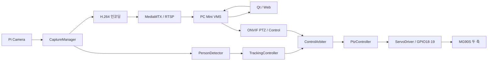

# Edge AI PTZ Camera & Mini VMS

Raspberry Pi 4와 MG90S 서보 두 개로 만든 2축 PTZ 카메라 프로토타입입니다.
Pi가 서보를 제어하고 IMX219 카메라 영상을 송출합니다. PC의 Qt UI는 별도
프로젝트에서 개발합니다. PC Mini VMS는 후속 구현 대상입니다.

## 최신 Edge Camera 구현

설정·대상 상태·수동 후 자동 복귀·독립 JSON 추적 스위치를 추가했다.
최신 소스/실행 방법과 이전 ONVIF 추적 계약의 차이는
[소프트웨어 보고서](docs/EDGE_CAMERA_SOFTWARE_REPORT.md)에 정리했다.
이 변경은 아직 설치 서비스에 반영하지 않았다. 실물 검증은 사용자가 진행한다.

## 프로젝트 구성

```text
PTZ_CAMERA/
├── edge-camera/         # Pi 통합 CMake 진입점 (기존 pi 소스 재사용)
├── pi/
│   ├── servo_test/       # pigpio 기반 PAN/TILT 키보드·TCP 제어 (C++17)
│   ├── onvif_service/    # ONVIF Device/Media/PTZ/Events (C++17)
│   └── camera_stream/    # C++17 카메라 송출·사람 탐지 → 서보 서비스·MediaMTX
├── common/              # 제어 제한, 탐지 metadata, 성능 계측
├── tools/performance/   # C++17 자원 수집·요약·비교 시험
├── docs/
│   ├── technology_decisions.md  # 기술 선택 이유와 검토 기준
│   ├── architecture.md          # 영상·객체 탐지·서보 제어 흐름
│   ├── object_detection_concepts.md # 신뢰도·IoU·NMS 설명
│   ├── performance/      # 시험 조건·예비 결과·해석
│   └── sessions/         # 작업 기록
└── troubleshotting.md    # 문제별 조사·조치 기록
```

현재는 Raspberry Pi만 사용합니다. ESP32 실험 코드와 PC Qt UI 코드는 이 저장소에
포함하지 않습니다.

## 전체 동작 구조



구성별 안내: [Pi 서비스](pi/README.md), [통합 빌드](edge-camera/README.md),
[공통 코드](common/README.md), [문서](docs/README.md), [도구](tools/README.md).
VMS의 Pi 영상 수신은 사용자가 확인했습니다. 최신 소스는 추적 ON/OFF에
`/camera/control`을 사용하며 Pi WebRTC/HLS 기본 설정은 OFF입니다.

## 서보 테스트

서보 신호는 BCM GPIO18(PAN), GPIO19(TILT), 중앙 복귀 버튼은 GPIO17과 GND에
연결합니다. 서보 두 개는 외부 4.8~6V 전원으로 구동하고 **Pi GND와 외부 전원
GND를 공통 연결**합니다. GPIO에는 서보 신호만 연결합니다.

```sh
sudo systemctl stop ptz-servo.service  # TCP 서비스가 실행 중일 때만
cmake -S pi/servo_test -B pi/servo_test/build
cmake --build pi/servo_test/build -j4
sudo ./pi/servo_test/build/servo_test --direct
```

키는 `a`/`d`(PAN), `w`/`s`(TILT), `c`(중앙), `q`(종료)입니다. 현재 범위는
PAN 25~155도, TILT 40~140도입니다. 자세한 내용은
[서보 코드](pi/servo_test/src/main.cpp)를 참고하세요.

서비스가 실행 중이면 `./pi/servo_test/build/servo_test`로 GPIO 충돌 없이
터미널 키 제어를 사용할 수 있습니다.

외부 PTZ·자동 추적·탐지 알림은 인증된 ONVIF PTZ/Events를 사용합니다. TCP 5000은 Pi 내부 IPC 전용입니다. 설치와 명령 형식은
[서보 제어 안내](pi/servo_test/README.md)를 참고하세요.

## 카메라 송출

Pi에 MediaMTX와 서비스를 설치하는 방법은 [카메라 송출 안내](pi/camera_stream/README.md)에
있습니다. 설치된 Pi에서는 다음 명령으로 송출을 켜거나 끕니다.

사람 자동 추적은 ONVIF `MoveAndStartTracking`으로 시작하고 `Stop`으로 종료합니다.
추적 중에는 내부 RTSP reader가 캡처를 유지하므로 시청자가 없어도 동작합니다.
카메라 송출기, 탐지 모델, 서보 서비스의 연결 흐름은 카메라 송출 안내에 정리했습니다.

```sh
sudo systemctl start ptz-camera.service
sudo systemctl stop ptz-camera.service
systemctl status ptz-camera.service
```

Pi의 현재 LAN 주소는 `hostname -I`로 확인합니다. 주소가 `192.168.0.92`라면
WebRTC는 `http://192.168.0.92:8889/cam/`, RTSP는
`rtsp://192.168.0.92:8554/cam`입니다. 현재 직접 연결 진단에 사용할 수 있습니다.
목표 구조에서는 VMS가 Pi 영상과 제어를 관리하고 Qt/Web은 VMS에 연결합니다.

## 기록

- [목표 구조와 이전 계획](docs/PROJECT_ARCHITECTURE.md)
- [Pi 모듈·metadata·캡처 유지 구현](docs/EDGE_CAMERA_IMPLEMENTATION.md)
- [Edge 통합 빌드와 코드 읽는 순서](edge-camera/README.md)

- [작업 기록](docs/sessions/2026-10-01.md)
- [2026-10-02 정리 기록](docs/sessions/2026-10-02.md)
- [2026-10-03 사람 자동 추적 기록](docs/sessions/2026-10-03.md)
- [RTSP TCP·UDP 비교](docs/rtsp_tcp_udp.md)
- [기술 선택과 판단 근거](docs/technology_decisions.md) — 앞으로 선택하거나 교체하는 기술의 이유를 기록합니다.
- [전체 동작 구조](docs/architecture.md) — Qt 명령에서 사람 탐지와 서보까지의 흐름을 설명합니다.
- [객체 탐지 개념](docs/object_detection_concepts.md) — 신뢰도, 박스 겹침(IoU), 중복 제거(NMS)를 설명합니다.
- [처리 구조·자원 사용량 측정](docs/performance/README.md) — 동기/비동기·스레드 수·버퍼 정책을 비교하고 실행 로그를 분석합니다.
- [2026-10-07 ONVIF 작업 기록](docs/sessions/2026-10-07.md)
- [2026-10-06 계측 작업 기록](docs/sessions/2026-10-06.md)
- [트러블슈팅](troubleshotting.md) — 새 문제를 조사할 때마다 여기에 추가합니다.

현재 알려진 문제: 카메라 원본 H.264에 간헐적으로 핑크색 프레임이 발생합니다.
자세한 조사 결과는 트러블슈팅 기록에 있습니다.

## ONVIF로 영상 주소 조회

Pi의 ONVIF 서비스는 LAN 검색과 RTSP URL 조회를 제공한다.
설치·시험은 [ONVIF 안내](pi/onvif_service/README.md), PC Qt에 전달할 구현 요청서는
[Qt 연결 문서](docs/onvif_qt_integration.md)에 있다.

ONVIF 조회와 외부 영상 시청에는 설정한 접속 계정이 필요하다. 로그인 정보는 소스에
넣지 않고 Pi의 private 설정 파일로 관리한다. Qt 인증 연결 방법은 위 문서에 있다.

PTZ 버튼·키 전환 요청서: [ONVIF PTZ Qt 연결](docs/onvif_ptz_qt_migration.md).
