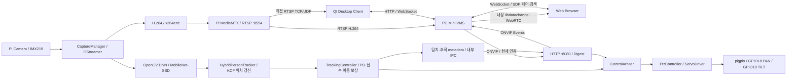

# Edge AI PTZ Camera

[문서 안내](docs/README.md) · [전체 구조](docs/SYSTEM_ARCHITECTURE.md) · [Pi 현재 구조](docs/EDGE_CAMERA_ARCHITECTURE.md)

Raspberry Pi 4에서 카메라 캡처·사람 탐지·자동 추적·PAN/TILT GPIO 제어·RTSP·ONVIF를 제공하는 C++17 프로젝트입니다. PC의 Mini VMS, Qt, Web은 별도 저장소이며 이미 구현되어 연동 검증을 진행하고 있습니다.

## 전체 시스템



Pi MediaMTX는 RTSP 서버로 유지합니다. PC MediaMTX 게이트웨이는 제거됐고 WebRTC 전송은 VMS 내부 libdatachannel이 담당합니다. Pi의 직접 WebRTC/HLS는 현재 구성에서 사용하지 않습니다.

## 책임과 구현 범위

| Pi | PC VMS | 클라이언트 |
|---|---|---|
| 캡처·H.264 인코딩 | RTSP 수신·중계·내장 WebRTC | Qt: Pi 직접 RTSP |
| OpenCV 사람 탐지·대상 선택 | ONVIF 제어·Events 수신 | Qt/Web: VMS 제어·상태 |
| 추적 보정·제어 중재·GPIO PWM | 분할 녹화·SQLite·탐지 색인 | Qt: 녹화 검색·로컬 재생 |
| ONVIF Device/Media/PTZ/Events | Gemini 조건 검증·자연어 검색 | Web: 라이브·검색·녹화 목록 |

DB·녹화·검색·Gemini API는 Pi에 구현하지 않습니다. 서보 서비스만 GPIO를 소유하며 카메라와 ONVIF는 loopback TCP 5000 IPC를 사용합니다.

## 소스 구조

```text
edge-camera/          # Pi 통합 CMake / camera.json
pi/
├── camera_stream/    # CaptureManager·H.264 publisher·DNN·Tracking
├── servo_test/       # ControlArbiter·PtzController·PigpioServoDriver
└── onvif_service/    # Digest·Device·Media·PTZ·Events·JSON control
common/               # 설정·제한·metadata·상태·rate limiter·계측
tools/                # 설치/진단 보조 및 성능 측정 도구
docs/                 # 설계·제어 계약·배포 차이·시험·작업 기록
```

사용 기술: C++17, CMake, Raspberry Pi OS/Linux, libcamera/GStreamer/x264, OpenCV DNN/KCF, pigpio, ONVIF, HTTP Digest, Expat, OpenSSL, nlohmann_json, MediaMTX(RTSP).

## 영상·메타데이터

캡처 영상은 인코딩 경로와 분석 경로로 나눕니다. 분석 경로는 오래된 대기 프레임을 버리고 최신 프레임을 사용하며, bbox는 영상에 직접 그리지 않고 메타데이터로 전달합니다.

사람 탐지 여부·confidence·bbox·기준 영상 크기·추적 상태·명령 각도 및 제공 가능한 frameId/streamEpoch/프레임·분석 시각을 ONVIF Events로 전달합니다. 필드가 없는 상태에는 임의의 값을 만들지 않습니다. Capture 시각은 PTS 기반 추정 UTC이며 센서 노출 시각을 보장하지 않습니다. pan/tilt는 명령 각도이고 실제 모터 도착 센서값이 아닙니다. 제조사 확장 Events를 사용하며 ONVIF Profile M 전체 인증을 주장하지 않습니다.

## 빌드와 서비스

```sh
cmake -S edge-camera -B edge-camera/build
cmake --build edge-camera/build -j2
ctest --test-dir edge-camera/build --output-on-failure
```

빌드는 소스 실행 파일을 만드는 작업입니다. 서비스 설치는 각 pi/*/install.sh가 담당하며 실제 운영 적용·실물 검증과 구분합니다.

설치된 서비스는 ptz-camera.service, ptz-servo.service, ptz-onvif.service입니다. 상태 조회:

```sh
systemctl status ptz-camera.service ptz-servo.service ptz-onvif.service
```

사용자 승인으로 송출을 시작·종료할 때 ptz-camera.service를 start/stop합니다. watchdog을 사용하는 설치에서는 timer가 자동 재시작할 수 있으므로 함께 확인합니다. 냉각·발열과 장시간 안정성은 실물 시험 항목입니다.

## 접속·하드웨어

| 용도 | 기본 값 |
|---|---|
| RTSP / profile | rtsp://<PI_IP>:8554/cam / main |
| Device | http://<PI_IP>:8080/onvif/device_service |
| PTZ | http://<PI_IP>:8080/onvif/ptz_service |
| 독립 추적 제어 | http://<PI_IP>:8080/camera/control |
| ONVIF Discovery | UDP 3702 / 같은 LAN |
| RTSP UDP | RTP 8000 / RTCP 8001 |
| Pi 내부 IPC | TCP 127.0.0.1:5000 |
| PAN / TILT 신호 | BCM GPIO18 / GPIO19 |
| 중앙 버튼 | GPIO17 / GND |

인증은 private 설정 파일을 사용하며 계정·비밀번호를 저장소나 로그에 포함하지 않습니다. VMS도 서버 로컬 설정에서 계정을 읽습니다. 실제 IP는 hostname -I로 확인합니다.

MG90S 서보 전원은 외부 4.8~6V, Pi GND와 공통 접지하며 GPIO는 신호선으로 사용합니다. 범위와 중앙은 적용 JSON 설정을 확인합니다. 직접 서보 진단은 [servo_test README](pi/servo_test/README.md)의 절차를 따릅니다.

## 관련 저장소·문서

[PTZ_VMS_Server](https://github.com/PTZ-CAMERA/PTZ_VMS_Server) · [Qt_Client](https://github.com/PTZ-CAMERA/Qt_Client) · [PTZ_WEB_Client](https://github.com/PTZ-CAMERA/PTZ_WEB_Client)

[통합 빌드](edge-camera/README.md) · [Pi 서비스](pi/README.md) · [공통 코드](common/README.md) · [문서](docs/README.md) · [도구](tools/README.md) · [Pi 설계](docs/EDGE_CAMERA_ARCHITECTURE.md) · [최신 변경 보고서](docs/EDGE_CAMERA_SOFTWARE_REPORT.md)

## 코드 안내

통합 CMake와 설치 경로를 유지하고 제어 소유권·추적 세대·메타데이터 시각의 설명 주석을 보완했습니다. [CODE_GUIDE](docs/CODE_GUIDE.md). 이번 정리는 동작·설정·서비스 적용을 변경하지 않습니다.
