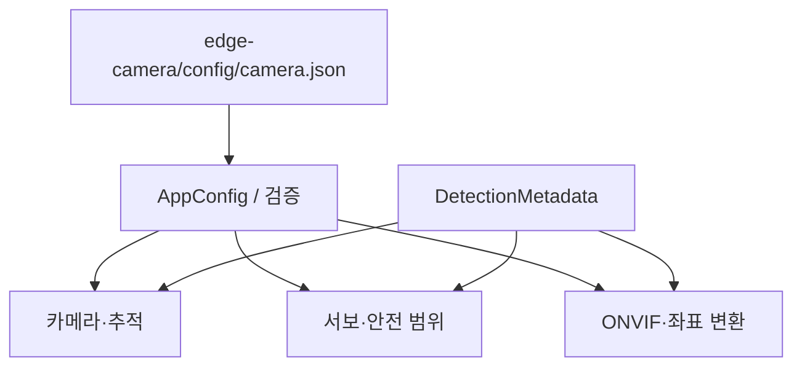

# 공통 코드

[문서 안내](../docs/README.md) · [전체 구조](../docs/SYSTEM_ARCHITECTURE.md) · [Pi 현재 구조](../docs/EDGE_CAMERA_ARCHITECTURE.md)

카메라·서보·ONVIF가 공유하는 설정, 자료형과 계측입니다.

## 디렉토리 구조

```text
common/
├── config/       # AppConfig, JSON 읽기·검증, 공통 CMake
├── control/      # PTZ 범위·좌표 변환
├── metadata/     # 탐지 IPC 자료형과 검증
├── runtime/      # 상태 enum, 로그, rate limiter
└── performance/  # CSV 성능 로그, GStreamer 계측
```

## 의존 구조



공통 코드는 GPIO나 카메라를 직접 열지 않습니다. 설정을 바꿀 때는 각 프로세스가
같은 설정 파일을 읽도록 적용해야 합니다. 실제 기본값은
[설정 예제](../edge-camera/config/camera.json)와 `config/app_config.h`를 확인하세요.

## 추적 송수신 공통 제한

`control/tracking_limits.h`는 보정량 파싱과 최대 ±6° 제한을 함께 둡니다.
송신기만 값을 높이면 서보 수신기가 거절할 수 있으므로 양쪽에서 같은 계약을 사용합니다.
`config/app_config.*`와 JSON 예제의 속도는 설정값이며 실측 성능 수치가 아닙니다.
