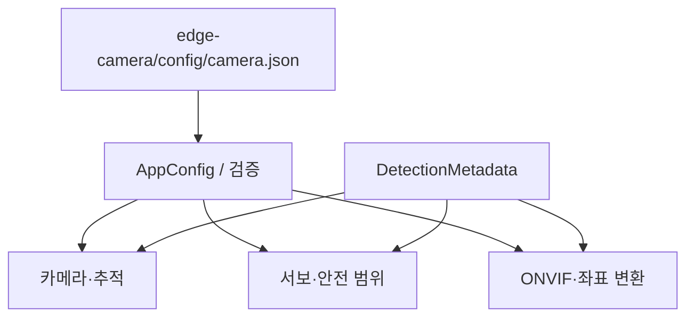

# 공통 코드

카메라·서보·ONVIF가 공유하는 설정, 자료형과 계측입니다.

## 디렉토리 구조

```text
common/
├── config/       # AppConfig, JSON 읽기·검증, 공통 CMake
├── control/      # PTZ 범위·좌표 변환
├── metadata/     # 탐지 IPC 자료형과 검증
├── runtime/      # 상태 enum, 로그, rate limiter
└── performance/  # CSV 성능 로그, GStreamer 계측
```

## 의존 구조



공통 코드는 GPIO나 카메라를 직접 열지 않습니다. 설정을 바꿀 때는 각 프로세스가
같은 설정 파일을 읽도록 적용해야 합니다. 실제 기본값은
[설정 예제](../edge-camera/config/camera.json)와 `config/app_config.h`를 확인하세요.

## 현재 시스템 연동 기준 (2026-10-11)

Qt 라이브는 Pi 직접 RTSP, Web 라이브는 PC VMS 내부 libdatachannel WebRTC입니다. PC MediaMTX 게이트웨이는 제거했고 Pi RTSP 서버는 유지합니다. 녹화·SQLite·자연어 검색은 VMS 책임입니다.

최신 Pi 소스의 독립 /camera/control 추적 설정과 VMS의 기존 ONVIF Tracking 계약은 아직 맞춰야 합니다. 소스 업데이트가 설치 서비스 적용을 의미하지 않습니다. 전체 역할·검증 범위는 [저장소 README](../README.md)를 기준으로 확인하세요.
