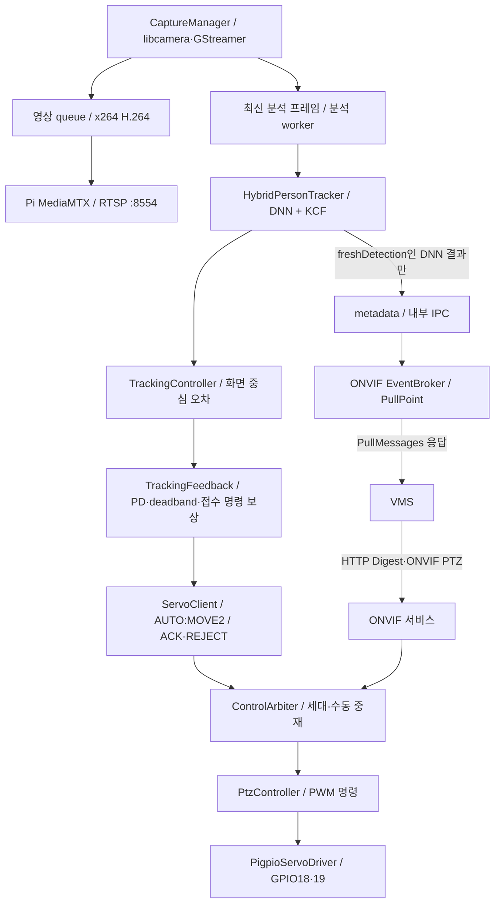

# Pi 현재 아키텍처

2026-10-11 작업 트리 기준. [전체 시스템](SYSTEM_ARCHITECTURE.md)

## 프로세스와 디렉토리

| 경로 | 책임 |
|---|---|
| pi/camera_stream | 캡처·발행·분석 worker·추적 계산·서보 IPC |
| pi/servo_test | 명령 해석·소유권/세대·이동 계획·유일한 GPIO 출력 |
| pi/onvif_service | HTTP Digest·XML·Device/Media/PTZ/Events·독립 JSON 제어 |
| common | 공통 설정·각도/추적 제한·metadata·계측 |
| edge-camera | 세 프로그램의 통합 CMake와 설정 예제 |
| tools / docs | 진단·성능 도구 / 계약·설계·시험·작업 기록 |

서보와 카메라를 한 프로세스로 합치지 않는다. 같은 소스를 edge-camera에 중복 복사하지 않고
통합 CMake에서 기존 pi/를 연결한다. install.sh와 systemd가 참조하는 경로는 보존한다.

## 탐지·추적의 의미

DNN 재검출 사이에 최대 4프레임 또는 500ms 조건으로 KCF 위치를 갱신한다.
실패/유효하지 않은 박스에서는 다시 DNN을 수행한다. KCF 위치 갱신은 새 confidence 추론이
아니므로 freshDetection과 구분하고 실제 DNN 결과만 탐지 metadata로 발행한다.

TrackingFeedback은 화면 중심의 정규화 오차에 기본 PD(ki=0), deadband, 시간당 보정량 상한,
ACK를 받은 이동 이력에 따른 보상을 적용한다. ACK는 명령 접수이며 실제 각도 센서값이 아니다.
보상 계수 0.02는 초기 설정값이고 실측 보정값이 아니다. 모드/세대/대상 변경·오래된 프레임은
관련 이력을 초기화한다.
