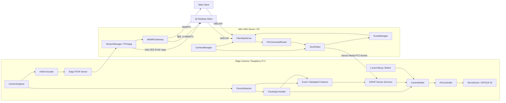

> 과거 설계/구현 기록입니다. 현재 작업 트리와 배포 차이는 [현재 구조](EDGE_CAMERA_ARCHITECTURE.md), [전체 시스템](SYSTEM_ARCHITECTURE.md)을 우선 확인하세요.

# Edge AI PTZ Camera & Mini VMS

- 작성일: 2026-10-07
- 상태: **목표 구조와 점진적 migration 계획**
- 기준: 현재 repository 소스, CMake, 서비스 설정, 저장된 테스트 결과 및 읽기 전용 운영 조회
- 초기 작성 범위: 분석과 문서 작성. 아래 현재 구조 분석은 구현 착수 전 기준이다.
- 후속 Pi 구현/운영 적용 결과: [EDGE_CAMERA_IMPLEMENTATION](EDGE_CAMERA_IMPLEMENTATION.md).

## 1. Project Goal

Raspberry Pi 4를 하나의 **Edge IP Pan/Tilt Camera**로 구성하고, PC의 **Mini VMS Server**가
카메라·영상·명령·메타데이터·클라이언트 접속을 중앙에서 관리한다.

- Edge: 영상 캡처, 사람 탐지, 자동 추적, 실제 서보 출력, H.264/RTSP, ONVIF Device 역할.
- VMS: 카메라 등록/상태, ONVIF Client, RTSP ingest, 이벤트/메타데이터 관리,
  PTZ routing, WebRTC gateway 관리, Client API.
- Qt: VMS 카메라 목록·영상·오버레이·상태·PTZ·로그를 제공하는 Desktop Client.
- Browser: VMS가 제공하는 WebRTC 영상·PTZ·추적 상태를 보여주는 Web Client.

자동 추적은 Edge 내부에서 수행한다. VMS/Qt의 영상 표시 지연이 자동 추적 입력에
들어가지 않게 한다. Edge는 자동 추적을 위해 자기 자신에게 ONVIF HTTP 명령을 보내지 않는다.

첫 목표는 카메라 1대를 **등록 → 영상 → 수동 PTZ → 자동 추적 → 메타데이터 표시**까지
연결하는 것이다. Recording/Playback/Event Search/Multiple Camera는 이후 확장한다.
MG90S 두 개로 구현한 것은 물리적 Pan/Tilt이며 optical Zoom은 현재 없다.

## 2. Current Repository Analysis

### 2.1 현재 파일/실행 구조

```text
pi/
├── camera_stream/   # C++ GStreamer 캡처/인코딩/탐지 + MediaMTX 설정
├── servo_test/      # pigpio GPIO 단일 소유자 + 제어/궤적 + 내부 TCP
└── onvif_service/   # Device/Media/PTZ/Events 소스 + 인증 + 진단 도구
common/              # 제어 제한값·계측 헤더
tools/performance/   # 자원 수집·비교 시험·가짜 GPIO 검증
docs/                # 구조·결정·이론·계약·세션·결과
troubleshotting.md   # 조사/해결 기록
```

`common/`은 root의 실제 디렉토리다. 위 세 Pi 프로젝트는 각각 CMake target과
systemd 생명주기를 가진다. root에서 Qt/VMS/Web 전체를 빌드하는 구조는 아직 없다.

- `ptz-camera.service`: MediaMTX를 실행. 시청자 접속 시 C++ publisher를 on-demand 실행.
- `ptz-servo.service`: pigpio 초기화와 PWM/버튼/궤적을 관리하는 단일 GPIO 소유자.
- `ptz-onvif.service`: HTTP SOAP/Digest와 UDP discovery를 제공하는 ONVIF Device 프로세스.

현재 카메라: IMX219. PAN=BCM18, TILT=BCM19, 중앙 버튼=BCM17.
서보 전원은 외부 4.8~6V이며 Pi GND와 공통 연결한다.

### 2.2 구현과 검증 상태

| 기능 | 현재 소스/설정 | 확인한 범위 | 남은 부분 |
| --- | --- | --- | --- |
| 캡처/송출 | libcamerasrc → tee → x264 → RTSP publish → MediaMTX | H.264 1280×720 수신 확인 | 실제 PC 표시 지연, 간헐적 핑크 프레임 원인 |
| 탐지 | OpenCV 4.5.1 DNN, CPU MobileNet-SSD, person, score/NMS | 모델 로딩·사진 탐지·예비 실행 시간 | 실제 사람 장면에서 품질/장기 부하 |
| 추적 | 최근 대상에 가까운 사람 선택, 중심 오차, deadband, 작은 보정 | 코드 경로·내부 제어·가짜 GPIO | 실제 이동 추종, 대상 소실/재획득 |
| 서보 | 각도 제한, 50Hz pulse, 중앙/키/버튼, 목표 궤적 | 기존 구동과 소프트웨어 테스트 | PAN 좌우 반전 보정, 물리 속도/정지 확인 |
| ONVIF Device/Media/PTZ | discovery, Device/Media 조회, 표준 PTZ, HTTP Digest | 기존 설치 서비스와 주소/상태/0변위 요청 확인 | Preset/설정 변경, 다른 클라이언트 호환성 |
| ONVIF 추적/Events | MoveAndStartTracking, PullPoint, renew/unsubscribe, vendor topics | 소스 구현·로컬 모의 HTTP/이벤트 테스트 통과 | **최신 버전 운영 적용 및 실제 VMS 연동 미완료** |
| metadata | 선택 사람의 중심/점수/오차/명령 각도 | 기존 내부 전달, 새 broker 모의 전달 | 외부 bounding box, frame ID/캡처 시각, 영상과 정렬 |
| 인증 | ONVIF HTTP Digest, MediaMTX 계정, root 전용 설정 | 정상/실패/무인증 접근 확인 | VMS 사용자/세션 인증, credential 관리 |
| PC VMS | 없음 | 없음 | Camera/Stream/Event/Router/API 전체 |
| Qt/Web | 이 repository에는 없음. Qt는 별도 PC 프로젝트 | 이 저장소에서 구현 검증하지 않음 | VMS Client로 전환, Web UI |
| 계측/주석 | C++ CSV·CPU/RSS·비교 시험, 전체 .cpp 한글 설명 보강 | 빌드와 저장된 테스트 | 새 시스템 경로의 지연/부하 측정 |

### 2.3 소스와 운영 버전을 구분한다

문서 작성 시 세 기존 서비스는 `active`였다. 최신 `onvif_events_check`로 설치된 서버를
조회하면 **Events service not found**였다. 새 Events/추적 구현은 source/build와 운영
설치 버전이 다르다. 기존 ONVIF PTZ 연결을 완료한 것과 새 Events migration의 완료는
구분해서 기록한다.

저장된 ONVIF CTest 6개가 통과했고 Events network 모의 시험의 synthetic
publish→응답은 약 3.17ms였다. 이는 **로컬 모의 통신만의 수치**다. 영상·AI·Qt 지연은 아니다.
이번 문서 작성에서 해당 미반영 코드를 새로 배포하지 않는다.

### 2.4 기존 소스의 재사용 지점

| 현재 위치 | 재사용 대상 |
| --- | --- |
| `pi/camera_stream/src/main.cpp` | GStreamer 구성, 캡처/송출 분기, 추론 작업 흐름, 종료/계측 |
| `person_detector.*` | PersonDetector와 모델 전처리/후처리 |
| `servo_client.*` | Edge 내부 IPC adapter. 외부 ONVIF Client로 바꾸지 않음 |
| `pi/servo_test/src/servo/servo_control.*` | 출력/공유 상태/오류 처리 및 GPIO 생명주기 |
| `motion/motion_plan.*` | 타임아웃·범위·목표 계산 |
| `button/*`, `keyboard/*` | 로컬 Debug와 중앙 버튼 |
| `pi/onvif_service/src/` | SOAP, XML, Digest, Device/Media/PTZ, Events/broker |
| `pi/onvif_service/tools/soap_client.*`, `probe.cpp` | PC OnvifClient의 초기 조회/검색 구현 기반 |
| `common/control/ptz_limits.h` | Edge 좌표 변환/출력 제한의 단일 정의 |
| `common/performance/*`, `tools/performance/*` | 계측/CSV/테스트 방법. 하드웨어 독립 부분 재사용 |

현재 SOAP 진단 라이브러리는 Pi server CMake에 연결돼 있다. PC에 전체 Pi CMake를
복사하지 않고 Client/XML 부분을 독립 target으로 추출한다. POSIX socket, machine-id,
libuuid/GPIO 의존성은 PC Client에 그대로 가져오지 않는다.

## 3. System Architecture



그림은 논리적 책임을 나타낸다. 기존 Edge 프로세스는 유지하고 IPC adapter로 경계를
만든다. GPIO는 계속 서보 프로세스 한 곳에서만 소유한다.
Qt/Web의 카메라 등록·제어·영상 접속 대상은 VMS다. Pi 직접 연결은 전환 기간의
진단 경로로만 유지한다.

## 4. Component Responsibilities

### 4.1 Edge Camera

| 모듈 | 책임 | 출력과 경계 |
| --- | --- | --- |
| CameraCapture | CSI 카메라를 한 번 열고 이미지와 시각을 확보 | 인코딩/분석 분기에 전달 |
| RtspPublisher | H.264 인코딩과 로컬 RTSP 발행 | Edge MediaMTX에 발행 |
| PersonDetector | 이미지에서 사람 bbox/confidence 계산 | 탐지 결과만 반환, 모터 제어 없음 |
| TargetSelector | 대상 선택과 소실/재획득 처리 | 초기에는 기존 중심 거리 방식 재사용 |
| TrackingController | 중심 오차·deadband·결과 나이로 이동량 계산 | 단위가 명확한 MoveRequest |
| ControlArbiter | 수동/자동/디버그 우선순위와 취소 처리 | 허용된 명령을 PtzController에 전달 |
| PtzController | 절대/상대/속도 이동, Stop, 범위와 타임아웃 관리 | ServoDriver 출력 목표 |
| ServoDriver | pigpio 초기화, pulse 출력, 종료 처리 | 이 계층만 GPIO 직접 접근 |
| OnvifDeviceServer | 외부 SOAP 요청을 검증하고 내부 명령으로 변환 | Device/Media/PTZ/Events 응답 |
| EdgeEventProducer | 카메라·추적·탐지 상태를 자료형으로 표현 | ONVIF 이벤트 broker에 전달 |

입력 출처에 따른 판단은 ControlArbiter에 둔다. PtzController는 명령이 AI/ONVIF/키보드
중 어디에서 왔는지 알 필요가 없다. 현재 GPIO 모듈에 섞인 추적 flag와 자동 이동 허용
판단을 외부로 분리한다. 이 클래스들은 **제안 구조**이며 모두 구현된 것은 아니다.

### 4.2 PC Mini VMS

| 모듈 | 책임과 인터페이스 |
| --- | --- |
| CameraManager | CameraId, 장치 UUID, 주소/profile, 등록/상태 관리. IP를 영구 ID로 쓰지 않음 |
| OnvifClient | 검색, Device/Media/PTZ 조회·명령, Digest 인증, Events 구독 갱신 |
| StreamManager | 카메라/profile별 FFmpeg RTSP 수신, packet 전달, 재접속과 상태 관리 |
| EventManager | 탐지/추적 이벤트 정규화, 최신 상태와 제한된 이력, 클라이언트 알림 |
| PtzCommandRouter | cameraId별 명령 전달, 조작자 권한/점유, 수동·추적 전환 |
| WebRtcGateway | H.264 전달, WebRTC 세션/ICE와 배포 상태 관리 |
| ClientApiServer | HTTP 명령·조회, WebSocket 상태/metadata, 인증·입력 검증 |
| CredentialStore | 카메라 인증 정보 서버 보관. 로그/URI/UI 응답에 비밀번호 노출 금지 |
| HealthMonitor | 장치 응답·영상·이벤트 상태 분리, 재시도와 장애 알림 |

PC MediaMTX를 WebRTC gateway로 재사용하는 방안을 우선 제안한다. C++ VMS는
카메라 관리·명령·이벤트·API를 직접 담당하며 gateway 설정/상태/세션을 관리한다.
MediaMTX 설치만으로 Mini VMS 구현이 완료되지는 않는다.

### 4.3 Qt / Web Client

- Qt: CameraList, LiveView, DetectionOverlay, PTZ/Tracking UI, SystemLog, VmsApiClient.
- Web: 카메라 목록, WebRTC Player, PTZ UI, 추적/탐지 상태 표시.
- 두 클라이언트가 같은 CameraId와 VMS API/상태 모델을 사용한다.
- 카메라 인증 정보와 내부 GPIO/IPC 접근은 서버에 둔다.
- Qt 영상은 VMS 관리 RTSP 또는 WebRTC로 제공하고 영상 공급자를 UI와 분리한다.
- 기존 PC Qt 프로젝트를 재사용한다. Pi에 Qt를 설치하지 않는다.

## 5. Network Protocol

| 통신 구간 | 프로토콜 | 역할 |
| --- | --- | --- |
| VMS → 카메라 검색 | WS-Discovery / UDP multicast 3702 | LAN 장치 발견 |
| VMS ↔ Edge 관리 | ONVIF SOAP HTTP(S), Digest | Device/Media/PTZ/Events. 현재 Edge는 HTTP 8080 |
| Edge → VMS 영상 | RTSP/RTP | 현재 Edge RTSP 8554. TCP/UDP는 조건별 평가 |
| Edge → VMS 이벤트 | ONVIF PullPoint | 구독, PullMessages, Renew, Unsubscribe |
| VMS ↔ Qt/Web | HTTP(S) + WebSocket | 명령/조회와 비동기 상태·metadata 전달 |
| VMS → Web 영상 | WebRTC | gateway와 ICE 세션 |
| VMS → Qt 영상 | VMS RTSP relay / WebRTC | VMS가 관리하는 영상 endpoint |
| Edge 내부 | 함수 호출 / loopback IPC | 기존 TCP 5000 adapter를 점진적으로 재사용 |
| Driver → 서보 | pigpio servo pulse | GPIO18/19, 50Hz, 외부 전원 |

HTTP(S)는 목표이며 현재 Pi 서버의 TLS 지원을 의미하지 않는다.
ONVIF는 장치/영상 정보·제어·이벤트 인터페이스다. 영상 전달은 RTSP/WebRTC가 담당한다.

### 5.1 Client API 제안 — 미구현

- `POST /api/v1/discovery`: VMS가 검색하고 후보 반환.
- `POST /api/v1/cameras`: 카메라 등록과 인증 정보 참조 저장.
- `GET /api/v1/cameras`, `GET /api/v1/cameras/{id}`: 목록/상태.
- `POST /api/v1/cameras/{id}/ptz`: 이동 종류, 좌표 공간, 값, timeout.
- `POST /api/v1/cameras/{id}/ptz/stop`: 정지 요청.
- `POST /api/v1/cameras/{id}/tracking`: 자동 추적 전환.
- `POST /api/v1/cameras/{id}/stream-sessions`: 시청 세션과 VMS 재생 주소 발급.
- `/api/v1/events`: WebSocket 연결로 상태·추적·탐지·로그 전달.

초기에는 HTTP 명령과 WebSocket 이벤트를 사용한다. 별도 raw TCP 외부 API는
추가 요구가 생길 때 검토한다. schemaVersion/requestId/cameraId와 단위를 명시하고
명령 접수와 실행 완료를 구분한다. 기존 Qt 입력/표시는 adapter를 통해 재사용한다.

### 5.2 현재 ONVIF 계약과 제한

- 서비스: `/onvif/device_service`, `/onvif/media_service`, `/onvif/ptz_service`.
- 현재 주소: `http://192.168.0.92:8080`, RTSP: `rtsp://192.168.0.92:8554/cam`.
  IP는 설치 환경에 따라 바뀌며 VMS는 조회된 주소를 사용한다.
- ProfileToken: `main`. AbsoluteMove/RelativeMove/ContinuousMove/Stop/GetStatus 구현.
- 절대 좌표: pan = 90 + 65x, tilt = 90 + 50y. 상대 이동: pan 변화 = 130x,
  tilt 변화 = 100y. 정규화 좌표 범위는 -1~1이며 출력 제한은 적용된다.
- PAN 25~155°, TILT 40~140°, 중앙 90°/90°. 실제 방향 반전은 아직 수정하지 않았다.
- 최신 소스의 추적 시작은 `MoveAndStartTracking`, 종료는 `Stop`에 연결되어 있다.
  현재 위치 또는 지정 PTZVector로 이동 후 추적한다. 운영 적용은 별도 확인이 필요하다.
- ObjectID/Geo/Preset 기반 추적, Zoom, 홈 복귀 및 Preset 관리는 현재 미지원이다.
- Events의 `urn:ptz-camera:events`는 제조사 확장 topic이다. GetEventProperties로 설명한다.
  현재 통지는 중심/점수/오차/명령 각도이며 ONVIF Profile M RTP metadata 구현은 아니다.
- 다른 제조사의 탐지 데이터는 별도 adapter가 필요하다. 전체 ONVIF 적합성 인증을 주장하지 않는다.

## 6. Video Flow

```text
Pi CSI
 → 기존 GStreamer capture/tee
 → 기존 x264 H.264
 → Edge RTSP(MediaMTX)
 → PC StreamManager(FFmpeg ingest)
 → PC 관리 relay/gateway
 → WebRTC(Web) 또는 VMS RTSP/WebRTC(Qt)
```

1. 카메라/profile당 영상 한 개를 수신해 여러 시청자에게 공유한다.
2. H.264가 브라우저/gateway 조건을 만족하면 압축 packet을 그대로 전달한다.
   codec/profile 호환성은 PC 경로에서 검증한다.
3. FFmpeg 수신·timeout·재접속·packet 전달은 StreamManager에 둔다.
   필요한 형식 변환은 별도 Transcoder로 분리하고 불필요한 재인코딩을 피한다.
4. WebRTC의 ICE/DTLS/SRTP는 검증된 gateway가 담당한다. C++ VMS가 관리 API를 감싼다.
5. Edge MediaMTX는 RTSP endpoint로 유지한다. 기존 Pi 직접 WebRTC 연결은
   VMS 경로 검증 후 일반 클라이언트에서 전환한다.

현재 publisher는 마지막 reader가 나가면 종료된다. VMS가 계속 수신하면 Pi도 계속
캡처한다. 시청자가 없어도 추적하려면 viewer/tracking 세션 참조 수로 수신을 유지하거나
Edge 캡처 생명주기를 분리해야 한다. 초기 refactoring에서 이 동작까지 동시에 바꾸지 않는다.

## 7. PTZ Control Flow

```text
Qt/Web → VMS Client API → PtzCommandRouter → OnvifClient
 → Edge ONVIF PTZ Adapter → ControlArbiter → PtzController
 → ServoDriver → GPIO PWM
```

- 버튼/키 누름은 ContinuousMove, 놓음/포커스 상실은 Stop에 연결한다.
- VMS는 카메라별 조작자 충돌을 관리하고 오래된 이동 명령을 쌓지 않는다.
- Edge는 수동 제어를 수락하면 자동 추적을 취소하고 이전 추론 결과를 버린다.
- ContinuousMove 갱신과 Edge timeout을 함께 사용해 연결 단절에도 이동이 지속되지 않게 한다.
- HTTP 성공은 접수 결과다. MG90S에는 위치 센서가 없으므로 상태의 각도는 명령/추정 각도다.
- Stop은 이동 계획을 취소하며 현재 pulse를 유지한다. 물리적 비상 정지 장치는 아니다.
- Preset은 후속 단계에서 Set/Get/Goto/Remove와 저장·중간 정지를 함께 구현한다.

## 8. Auto Tracking Flow

```text
Capture → PersonDetector → DetectionResult → TargetSelector
 → TrackingController → ControlArbiter → PtzController → ServoDriver
```

압축 전 이미지에서 bbox 중심과 errorX/errorY를 계산한다. Edge가 자기 자신에게 ONVIF를
보내지 않는다. 초기에는 기존 ServoClient를 InternalControlPort adapter로 재사용한다.

기존 전처리, confidence/NMS, deadband, 최대 보정량, 오래된 결과 폐기를 유지하고
main.cpp의 대상 선택/오차/이동량 계산을 작은 모듈로 추출한다.
현재 최근 중심에 가까운 대상 선택은 Re-ID나 안정적인 다중 객체 ID 추적이 아니다.

### 8.1 Metadata 보강

PersonDetector는 bbox를 계산하지만 외부 통지에는 폭/높이가 없다. 오버레이 연결 전에
다음 계약을 추가한다.

- profile/source token, frameId, 원본 이미지 크기.
- bbox x/y/width/height, class, confidence, 선택 대상 여부.
- 캡처 시각, 분석 시각, 이벤트 생성 시각을 각각 정의.
- errorX/errorY, 추적 모드, 명령 pan/tilt 각도.
- 안정적인 object ID는 실제 추적기가 보장할 수 있을 때만 제공.

VMS는 CameraId, 수신 시각, sequence를 추가한다. frameId만으로 RTSP/WebRTC 영상과
시간이 맞는 것은 아니다. 초기에는 최신 유효 metadata를 표시하고 영상 timestamp/시계
대응을 확인해 동기화를 개선한다. 오래된 결과와 순서가 뒤바뀐 결과의 폐기 규칙을 명시한다.

## 9. Class/Module Structure

다음은 목표 디렉토리 제안이다. 이번 작업에서 파일을 이동하지 않는다.

```text
edge-camera/
├── CMakeLists.txt
├── apps/
│   ├── camera-publisher/    # 기존 publisher 진입점
│   ├── ptz-daemon/          # GPIO 단독 소유 프로세스
│   └── onvif-device/        # 기존 ONVIF 진입점
├── include/edge/
└── src/
    ├── capture/            # CameraCapture, FrameSource
    ├── detection/          # PersonDetector, DetectionResult
    ├── tracking/           # TargetSelector, TrackingController
    ├── control/            # ControlArbiter, PtzController, MotionPlan
    ├── hardware/           # ServoDriver, PigpioServoDriver
    ├── streaming/          # RtspPublisher, EdgeMediaServerAdapter
    ├── onvif/              # Device/Media/PTZ/Events/XML/Auth
    ├── metadata/           # EdgeEventProducer
    └── ipc/                # InternalControlPort, loopback adapter
vms-server/
├── CMakeLists.txt
├── apps/mini-vms/
├── include/vms/
└── src/
    ├── camera/             # CameraManager, CameraRegistry
    ├── onvif/              # OnvifClient, DiscoveryClient, EventSubscription
    ├── streaming/          # StreamManager, FfmpegIngest, PacketRelay
    ├── events/             # EventManager, MetadataNormalizer
    ├── control/            # PtzCommandRouter, ControlLease
    ├── webrtc/             # WebRtcGateway, MediaMtxGatewayAdapter
    ├── api/                # HttpApi, WebSocketEventHub
    ├── security/           # CredentialStore, ClientSession
    └── health/             # HealthMonitor, RetryPolicy
qt-client/                  # 기존 PC Qt 프로젝트 재사용
web-client/                 # HTML/JS player와 VMS API UI
docs/
common/                     # 필요한 공통 자료형/정의/계측만 공유
tools/                      # 기존 진단/성능 도구
pi/                         # 이전 과정에서 기존 빌드/install wrapper 유지
```

### 9.1 핵심 인터페이스 제안

| 인터페이스 | 계약 |
| --- | --- |
| IFrameSource | FrameLease/FrameInfo로 이미지 소유권, 시각, 크기 전달 |
| PersonDetector::detect | 읽기 전용 이미지 → vector<PersonDetection> |
| TrackingController::update | 탐지/대상 상태 → optional<MoveRequest> |
| ControlArbiter::submit | 입력 출처/모드/세대 검사 → 허용된 제어 명령 |
| PtzController::execute | 출처와 독립적인 Move/Stop, 각도/속도 단위 명시 |
| IServoDriver::write | 축/pulse 출력과 오류 결과. ONVIF/AI를 모름 |
| EdgeEventProducer::publish | 자료형으로 표현된 상태/탐지를 event broker로 전달 |
| OnvifClient | 비동기 검색/조회/이동/정지/구독, 카메라별 인증/profile 관리 |
| StreamManager::acquire/release | cameraId/profile/세션 목적별 공유 영상 생명주기 |
| EventManager::latest/subscribe | 정규화 상태 조회/갱신 알림, 최신 값 우선 |
| PtzCommandRouter::route | cameraId/operator/requestId 검사 후 ONVIF 요청 |
| ClientApiServer | 등록/조회/제어/영상 세션과 WebSocket 계약 |

기존 함수를 감싸는 adapter부터 만들고 하드웨어·플랫폼·통신·시험 경계에서만 추상화한다.
모든 함수를 클래스로 바꾸기 위한 전면 재작성은 하지 않는다.

### 9.2 실행과 소유권

- Edge 캡처/인코딩은 GStreamer, 추론은 기존 worker, 서보는 기존 제어 loop를 유지한다.
- PtzController 상태와 ServoDriver 출력은 하나의 실행 주체가 관리한다.
- 버튼 callback은 짧게 입력을 전달하고 긴 작업을 수행하지 않도록 정리한다.
- VMS 네트워크/event I/O, 카메라 수신 worker, gateway 관리 책임을 분리한다.
- callback에 이미지/상태 수명을 명시하고 종료 시 worker를 정리한다.
- 연결 단절 후 오래된 이동을 재실행하지 않는다. Stop을 우선 처리한다.
- 코어 고정은 별도 비교 시험으로 진행한다. 구조 변경과 동시에 적용하지 않는다.

## 10. 목표 구조와 현재 구조의 차이

| 항목 | 현재 | 필요한 작업 |
| --- | --- | --- |
| 관리 주체 | Qt가 Pi에 직접 접속 | VMS 등록/상태/명령 계층 추가 |
| 영상 | Pi MediaMTX → 클라이언트 | Pi RTSP → PC 수신/gateway → 클라이언트 |
| 자동 추적 | camera main, 내부 TCP, 서보 전역 상태 | detector/selector/tracking/arbiter/controller/driver 분리 |
| 입력 출처 | GPIO 모듈에도 자동/수동 판단 포함 | ControlArbiter로 분리 |
| Metadata | 중심/점수/오차, 새 Events 운영 미반영 | bbox/시각 추가, 운영 적용, VMS 정규화/WS |
| 상태 | 장치 연결과 영상 상태 구분 보강 필요 | deviceReachable/streamLive/trackingActive 분리 |
| PC ONVIF | Pi 진단 도구만 존재 | 독립 Client, 인증/구독/재접속 관리 |
| Preset | 관리 미지원 | 기본 경로 검증 후 저장/조회/이동/삭제 |
| Client API | 카메라 직접 SOAP/기존 TCP | VMS HTTP/WS, 서버측 인증 정보 보관 |
| 빌드 | Pi 프로젝트 세 개 | component별 target과 이전 경로 호환 |

## 11. Implementation Roadmap / Migration Order

### Phase 0 — 현재 동작 기준 확보

1. 미커밋 변경과 소스/빌드/설치 버전 차이를 기록한다.
2. 캡처/RTSP/ONVIF/PTZ/인증의 현재 동작과 복구할 binary/config를 확인한다.
3. 새 Events/MoveAndStartTracking은 소스 시험·운영 적용·PC 연동을 분리해 기록한다.
4. PAN 방향, 핑크 프레임, 실제 사람 추적은 미해결/미검증 목록에 유지한다.

완료 조건: 동작 기준과 복구 대상이 명확하고 인증 정보가 Git에 들어가지 않음.

### Phase 1 — Edge 기능 추출

1. 기존 PersonDetector를 유지하고 TargetSelector/TrackingController를 main에서 추출한다.
2. 기존 GPIO/궤적 함수를 감싸 ServoDriver/PtzController를 분리한다.
3. 수동/자동/디버그 우선순위와 예약/취소를 ControlArbiter로 옮긴다.
4. 기존 IPC, 실행 파일 이름, 서비스 설치 경로를 유지한다.

완료 조건: 기존 시험과 모의 driver에서 범위/timeout/Stop/수동 우선/종료 동작이 동일함.

### Phase 2 — Edge 외부 계약 정리

1. 소스의 Events와 추적 API를 실제 운영 응답에 맞춰 정리한다.
2. bbox/이미지 크기/frame/시각을 metadata와 topic 설명에 추가한다.
3. Pi 단독 RTSP·ONVIF·이벤트·PTZ 연결을 확인한다.
4. Preset은 기본 계약 검증 이후 별도 기능으로 추가한다.

완료 조건: 운영 응답, 지원 기능, 미지원 항목이 문서와 일치함.

### Phase 3 — PC VMS 관리/제어 MVP

1. PC OS/컴파일러/FFmpeg 개발 환경과 HTTP/WS 라이브러리를 확인한다.
2. 기존 SOAP 진단 코드를 독립 OnvifClient 라이브러리로 추출한다.
3. CameraManager, CredentialStore, HealthMonitor, Client API를 구현한다.
4. PtzCommandRouter로 cameraId → ONVIF 제어를 연결한다.
5. EventManager가 PullPoint를 구독하고 VMS WebSocket으로 전달한다.

완료 조건: 클라이언트가 VMS API로 한 카메라의 상태·PTZ·추적을 관리함.

### Phase 4 — PC 영상 중계 MVP

1. FFmpeg StreamManager의 RTSP 수신·packet 전달·재접속을 구현한다.
2. VMS가 관리하는 PC MediaMTX gateway에서 WebRTC/RTSP relay를 제공한다.
3. 시청/추적 세션 참조 수로 수신 생명주기를 관리한다.
4. 영상·이벤트 시각과 오버레이 표시 규칙을 검증한다.

완료 조건: Pi → VMS → Qt/Web 영상·metadata·수동 제어·추적 전환 경로가 성립함.

### Phase 5 — 디렉토리 이전

1. 검증된 모듈부터 edge-camera/vms-server로 옮기고 CMake를 갱신한다.
2. 기존 pi 빌드/install은 wrapper로 같은 target/설치 경로를 유지한다.
3. PC Qt 프로젝트 위치와 빌드 조건을 확인해 재사용하거나 별도 저장소 참조를 유지한다.
4. root에서 Edge/VMS/Qt 빌드를 선택하도록 한다. Pi 빌드에 PC UI 의존성을 넣지 않는다.

완료 조건: 기존 실행/설치 절차와 새 component 빌드가 모두 유지됨.

### Phase 6 — 실물 시험과 확장

- PAN 방향 보정, 사람 추종/소실/재획득, 수동 개입, 연결 단절/timeout 시험.
- RTSP TCP/UDP·WebRTC, 추적 OFF/ON별 표시 지연·frame gap·CPU/RSS/온도 비교.
- PC 중계 추가 지연을 측정하고 추론/모의 이벤트 시간과 구분.
- 측정 후 코어 배치·하드웨어 인코딩을 각각 별도 변경으로 평가.
- MVP 검증 이후 Recording/Playback/Event Search/Multiple Camera 추가.

## 12. 기존 코드를 보존하는 Refactoring Plan

- 기능 추출과 알고리즘 변경을 분리하고 작은 단계마다 검증한다.
- GStreamer/x264/MediaMTX/OpenCV/pigpio를 재사용한다.
- GPIO 초기화 주체를 늘리지 않는다. 기존 daemon과 새 daemon이 동시에 GPIO를 열지 않게 한다.
- 초기 단계의 ONVIF/RTSP endpoint, credential 파일, 설치 binary 경로는 유지한다.
- metadata 추가는 schemaVersion/선택 필드로 시작하고 기존 수신자와 차이를 기록한다.
- 빌드/시험 → 로컬 계약 확인 → 필요한 실물 확인 → 해당 서비스 적용 순서로 진행한다.
- 복구는 변경한 binary/config/adapter 단위로 가능하게 한다.
- Preset·화질·방향·코어 배치 변경을 구조 정리와 동시에 섞지 않는다.

## 13. 구현 담당 범위와 후속 확인 사항

| 작업 영역 | 구현 범위 |
| --- | --- |
| 현재 Pi 작업 공간 | Edge 모듈 분리, ONVIF/metadata 계약, 하드웨어 제어 유지, 시험/계측/문서 |
| PC VMS 백엔드 | C++ CameraManager/OnvifClient/StreamManager/EventManager/Router/API 및 gateway adapter 구현 |
| Qt/Web | VMS API 계약 제공, 기존 Qt 연결부 전환 지원, WebRTC/PTZ 화면 연동. 실제 UI 작업·검증은 PC에서 진행 |

PC VMS 코드는 작성할 수 있지만 FFmpeg 수신과 WebRTC의 실제 빌드/성능은 PC 실행
환경에서 검증해야 한다. PC OS/CPU/컴파일러, Qt 저장소 위치, FFmpeg 개발 라이브러리,
서버/gateway 배치와 포트, HTTP/WS 라이브러리는 구현 착수 시 확인할 항목이다.

다음 구현 단위는 Phase 0의 동작 기준 확보 후 Phase 1의 작은 Edge 책임 추출이다.
초기 설계 이후 사용자 지시로 Pi 기능 분리·metadata·캡처 유지·Events 운영 적용을 진행했다.
최신 결과는 별도 구현 기록을 참고한다. PC VMS와 Preset은 후속이며 Git push는 하지 않았다.
