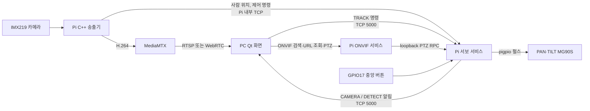

# PTZ 카메라 동작 구조

이 프로젝트에서 카메라·서보 제어는 Raspberry Pi 4가 실행한다. Qt 화면은 PC의 별도
프로젝트에 있다. Pi는 한 번 연 카메라의 영상을 **송출**과 **사람 탐지**에 함께 사용한다.

## 코드 위치

| 위치 | 담당하는 일 |
| --- | --- |
| `pi/camera_stream/src/main.cpp` | 카메라를 열고 송출·탐지 경로로 분리한다. 사람 위치에서 작은 PAN/TILT 보정량을 계산한다. |
| `pi/camera_stream/src/person_detector.*` | MobileNet-SSD 신경망으로 영상에서 `person` 박스와 신뢰도를 찾는다. |
| `pi/camera_stream/src/servo_client.*` | 송출기와 서보 서비스 사이의 Pi 내부 TCP 연결을 관리한다. |
| `pi/camera_stream/mediamtx.yml` | 시청자가 접속할 때 송출기를 시작하고, 떠나면 종료한다. |
| `pi/onvif_service/src/` | ONVIF Probe, Device/Media SOAP 요청에 응답하고 기존 RTSP URL을 반환한다. 카메라·GPIO를 열지 않는다. |
| `pi/servo_test/src/main.cpp` | 실행 모드 선택, 초기화, 입력 대기 루프, 종료 순서를 관리한다. **GPIO를 직접 제어하는 프로그램은 이 서비스 한 개다.** |
| `pi/servo_test/src/config.h` | GPIO 번호, 각도 제한, TCP 포트, 버튼 debounce 설정을 모은다. |
| `pi/servo_test/src/servo/servo_control.*` | 각도와 추적 상태를 관리하고 pigpio 서보 펄스를 출력한다. 공유 각도와 GPIO 쓰기는 mutex로 보호한다. |
| `pi/servo_test/src/button/center_button.*` | GPIO17 풀업 입력, 콜백, debounce, 중앙 복귀를 처리한다. |
| `pi/servo_test/src/keyboard/keyboard_control.*` | 터미널 설정·복원, 키 입력, 로컬 TCP 키보드 클라이언트를 처리한다. |
| `pi/servo_test/src/network/tcp_server.*` | 연결과 수신 버퍼를 관리하고 개행 단위 명령을 프로토콜 처리기로 전달한다. |
| `pi/servo_test/src/protocol/command_protocol.*` | PTZ/TRACK/AUTO 명령을 해석하고 카메라 등록과 Qt 알림을 처리한다. |

모델 파일은 `pi/camera_stream/fetch_model.sh`가 내려받아 SHA-256을 확인하고,
`install.sh`가 `/usr/local/share/ptz-camera/`에 설치한다. 모델 출처와 라이선스는
[카메라 송출 안내](../pi/camera_stream/README.md)에 있다.

## 사람이 움직일 때

1. Qt에서 영상 시청자가 `/cam`에 접속하면 MediaMTX가 C++ 송출기를 시작한다.
2. Qt가 서보 서비스에 `TRACK:ON\n`을 보내면 송출기가 사람 탐지를 시작한다.
3. 신경망은 최대 10fps로 들어오는 640×360 영상에서 사람의 박스를 찾는다.
   추론이 늦으면 대기 중인 과거 프레임을 버린다. 600ms보다 오래된 결과로는
   서보를 움직이지 않는다.
4. 송출기는 사람 중심과 화면 중심의 차이로 축마다 한 번에 최대 3°의 이동량을
   계산한다. 화면 중앙 8% 안에서는 움직이지 않는다.
5. 서보 서비스는 각도를 PAN 25~155°, TILT 40~140°로 제한한 뒤 pigpio에
   펄스폭을 지정한다. `DETECT:person,...` 메시지를 Qt에 전달한다.
6. 사람이 보이지 않으면 서보를 현재 위치에 두고 `NO_DETECTION`을 보낸다.

수동 ONVIF PTZ·Pi 로컬 키 명령이나 GPIO17 중앙 버튼을 사용하면
자동 추적이 꺼진다. 수동 제어를 계속하려면 Qt에서 추적 모드를 다시 켜야 한다.

## 메시지와 서비스

- **Qt → 서보 서비스:** `TRACK:ON`, `TRACK:OFF`. PTZ 이동은 ONVIF HTTP로 전송한다. 주소는 Pi의
  `<PI_IP>:5000`, 각 명령은 개행으로 끝난다.
- **송출기 → 서보 서비스:** Pi 내부 `127.0.0.1:5000`으로 접속해 `CAMERA:HELLO`로
  자신을 등록한다. 그 연결에서 추적 상태를 확인하고 `AUTO:MOVE`·`AUTO:DETECT`를
  보낸다. 단순한 `TRACK:STATUS` 조회는 카메라 연결 상태를 바꾸지 않는다.
- **서보 서비스 → Qt:** `CAMERA:CONNECTED/DISCONNECTED`,
  `DETECT:person,<confidence>,<x>,<y>,<errorX>,<errorY>,<pan>,<tilt>`,
  `NO_DETECTION`. 좌표는 1280×720 송출 영상 기준이다. Qt가 이미 받은
  `TrackingInfo` 신호를 화면에 표시하려면 PC의 Qt UI 코드와 연결해야 한다.
- **실행:** `ptz-servo.service`는 계속 실행된다. `ptz-camera.service`는 MediaMTX를
  실행하고, 실제 카메라 송출기는 시청자가 있을 때만 실행된다.

현재 Pi 단독 시험에서는 모델 로딩, RTSP 디코딩, Qt 메시지 전달, 1° 자동 명령과
중앙 복귀를 확인했다. 실제 사람이 움직일 때의 탐지 품질과 장착된 서보의 좌우·상하
방향은 현장에서 확인해야 한다. 측정값과 선택 이유는
[기술 선택 기록](technology_decisions.md), 문제 조사 내용은
[트러블슈팅 기록](../troubleshotting.md)에 이어서 기록한다.

## ONVIF 주소 조회

Qt는 UDP 3702 Probe로 Device XAddr를 얻고, TCP 8080에서 GetServices → GetProfiles →
GetStreamUri를 호출해 `rtsp://<PI_IP>:8554/cam`을 받는다. 영상에 접속하면 기존
on-demand 송출이 시작한다. ONVIF 서비스 자체는 한 poll 이벤트 루프에서 짧은 요청만
처리하며 인코딩·추론을 하지 않는다. 상세 지원 범위와 Qt 요청서는
[ONVIF 연결 문서](onvif_qt_integration.md)에 있다.

### 접속 인증

장치 검색은 공개이고 ONVIF HTTP 조회는 Digest 인증을 요구한다. MediaMTX도 외부
영상 시청에 같은 계정을 요구한다. Pi 내부 loopback의 송출/워치독/metrics는 예외다.
실제 계정 파일과 생성된 MediaMTX 설정은 저장소 밖 root/0600으로 관리한다.
Qt에서는 ONVIF 인증 콜백과 영상 플레이어에 계정을 각각 연결해야 한다.
TCP 5000 제어 인증은 별도이며 이번 변경 범위에 포함하지 않는다.

### ONVIF PTZ 전환

GetServices에서 PTZ XAddr를 제공하고 프로파일에 PTZConfiguration을 연결한다.
ONVIF 서비스는 좌표/Timeout을 검증한 뒤 서보 서비스의 loopback RPC에 전달한다.
서보의 20ms 루프가 궤적을 갱신하며 입력·버튼·자동 추적과 같은 mutex를 사용한다.
외부 PTZ 문자열은 거부하고 로컬 키 입력은 유지한다.
[Qt PTZ 변경 요청서](onvif_ptz_qt_migration.md)에 상세 계약을 정리했다.
