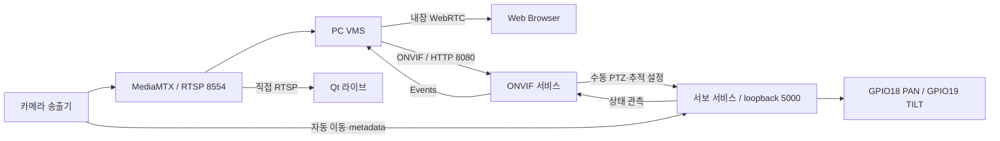

# Raspberry Pi Edge Camera 서비스

[문서 안내](../docs/README.md) · [전체 구조](../docs/SYSTEM_ARCHITECTURE.md) · [Pi 현재 구조](../docs/EDGE_CAMERA_ARCHITECTURE.md)

Pi는 영상 캡처·사람 탐지·자동 추적·물리 PTZ·RTSP·ONVIF를 담당합니다.
PC VMS와 Qt/Web Client는 별도 프로젝트입니다.

## 디렉토리 구조

```text
pi/
├── camera_stream/    # 단일 캡처, H.264 발행, DNN·추적
├── servo_test/       # GPIO 단독 소유, PTZ 중재와 PWM
└── onvif_service/    # Device/Media/PTZ/Events, 인증과 JSON 제어
```

## 서비스 구조



`ptz-servo`만 GPIO를 초기화합니다. 카메라와 ONVIF 프로세스는 내부 IPC를 사용합니다.
최신 소스와 설치된 서비스의 버전이 다를 수 있으므로 적용 상태는
[소프트웨어 보고서](../docs/EDGE_CAMERA_SOFTWARE_REPORT.md)를 확인하세요.

설치·실행: [카메라](camera_stream/README.md), [서보](servo_test/README.md),
[ONVIF](onvif_service/README.md). 통합 빌드는 [edge-camera](../edge-camera/README.md)에 있습니다.
