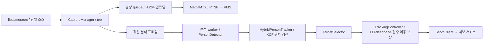

# Raspberry Pi 카메라 송출

[문서 안내](../../docs/README.md) · [전체 구조](../../docs/SYSTEM_ARCHITECTURE.md) · [Pi 현재 구조](../../docs/EDGE_CAMERA_ARCHITECTURE.md)

Pi의 C++17 송출기(`src/main.cpp`)가 GStreamer 라이브러리로 IMX219 영상을
캡처하고 H.264로 인코딩하여 Pi MediaMTX에 RTSP로 발행합니다. WebRTC는 PC VMS가 담당합니다.
저장소 기본 설정은 Pi WebRTC/HLS를 끄지만 기존 설치 설정은 다를 수 있습니다. Raspberry Pi 4 / Raspberry Pi OS
Bullseye에서 확인한 구성입니다.

카메라는 한 번만 열고 압축 전 영상을 두 경로로 나눕니다.

## 현재 분석·제어 경로

`HybridPersonTracker`는 DNN 검출 사이 KCF로 위치를 갱신합니다. `TrackingFeedback`은
화면 중심 오차와 접수된 이동 이력을 사용합니다. 새 ONVIF 탐지 metadata는 실제 DNN
결과에만 연결하며 KCF 갱신을 새 confidence 측정으로 기록하지 않습니다.
`ServoClient`는 AUTO:MOVE2 응답 ACK/REJECT를 소비해 다음 상태 조회와 섞이지 않게 합니다.
[구조·제한·배포 차이](../../docs/EDGE_CAMERA_ARCHITECTURE.md)

## 디렉토리 구조와 최신 처리 흐름

```text
camera_stream/
├── CMakeLists.txt / install.sh
├── mediamtx.yml          # RTSP·demand 실행 설정
├── src/
│   ├── main.cpp          # 초기화·분석 worker·종료
│   ├── camera/           # CaptureManager / 단일 카메라 분기
│   ├── person_detector.* # MobileNet-SSD / confidence / NMS
│   ├── servo_client.*    # 내부 IPC와 metadata
│   └── tracking/         # 대상 선택·추적 보정·capture lease
├── models/               # 모델·라이선스
└── tests/                # 캡처·추적 확인 도구
```



영상 경로와 분석 worker는 독립적으로 진행합니다. 오래된 분석 프레임은 버리며
박스를 영상에 그리지 않고 metadata로 전달합니다. 최신 저장소 설정은 Pi WebRTC/HLS를
끄고 VMS가 WebRTC를 담당합니다. 아래 직접 WebRTC/HLS 연결 안내는 이전 설치 설정의
진단용이며, 최신 추적 제어 계약은 [보고서](../../docs/EDGE_CAMERA_SOFTWARE_REPORT.md)를 참고하세요.

```text
libcamerasrc → tee ┬→ queue → videoconvert → x264enc → h264parse → MediaMTX → Qt 영상
                   └→ 최신 프레임 queue → 640×360·10fps 입력 → MobileNet-SSD → 서보 서비스 → Qt 탐지 정보
```

파일별 역할은 다음과 같습니다.

| 파일 | 역할 |
| --- | --- |
| `src/main.cpp` | GStreamer 영상 분기, 최신 프레임 선택, 사람 중심과 화면 중심 비교 |
| `src/person_detector.h/.cpp` | OpenCV DNN으로 MobileNet-SSD 실행, `person` 박스 추출 |
| `src/servo_client.h/.cpp` | Pi 내부 TCP 5000으로 추적 상태 조회·서보 이동·탐지 정보 전송 |
| `models/` | 다운로드한 모델 정의·가중치·라이선스. 큰 가중치 파일은 Git에서 제외 |
| `fetch_model.sh` | 고정한 원본 버전의 모델을 내려받고 SHA-256 확인 |

탐지 실행은 적용된 Tracking 설정과 detectionWhenDisabled에 따릅니다. 최신 소스는 독립 /camera/control 추적 스위치를 제공하고 기존 ONVIF 시작 명령도 호환 경로로 유지합니다.
내부 capture lease가 추적 중 영상을 유지하므로 시청자 접속이 필수는 아닙니다.
10fps는 탐지기에 공급하는 영상의 상한이며 신경망 추론 속도는 Pi의 CPU 상태에
따라 달라집니다. 분석 경로는 대기 중인 오래된 프레임을 버리고 최신 프레임만
유지합니다. 현재 OpenCV DNN은 2개 스레드를 사용합니다.
최신 소스의 Stop·수동 명령은 수동 계획을 중재하며 추적 설정 ON이면 유예 후 AUTO로 복귀할 수 있습니다. 추적 설정 OFF는 독립 tracking_set(false)를 사용합니다.
사람을 놓치면 현재 위치에서 멈추고 ONVIF 탐지 이벤트에 Detected=false를 전달합니다.

MediaMTX는 카메라 드라이버나 인코더가 아니라 영상 서버입니다. C++ 송출기가
발행한 한 스트림을 여러 시청자에게 전달하고, WebRTC/HLS 접속도 제공합니다.
MediaMTX 프로세스는 서비스가 실행되는 동안 대기합니다. 시청자 또는 추적용 내부
reader가 `/cam`에 접속하면 C++ 송출기를 시작하고, 마지막 reader가 떠난 뒤
5초가 지나면 송출기를 종료합니다. 새 연결은 카메라 시작을 기다리므로 처음에 약간 지연될 수 있습니다.

## 설치

1. [MediaMTX 공식 릴리스](https://github.com/bluenviron/mediamtx/releases)에서
   Linux arm64 바이너리를 내려받아 `/usr/local/bin/mediamtx`에 설치합니다.
   이 Pi에는 v1.21.1이 이미 설치되어 있습니다.
2. C++ 빌드, GStreamer 및 OpenCV 개발 패키지를 설치합니다.

   ```sh
   sudo apt update
   sudo apt install cmake g++ pkg-config curl libavformat-dev libavcodec-dev libavutil-dev libgstreamer1.0-dev \
     libgstreamer-plugins-base1.0-dev libopencv-dev \
     libcamera0 gstreamer1.0-plugins-base \
     gstreamer1.0-plugins-ugly gstreamer1.0-rtsp
   ```

3. 프로젝트 루트에서 `sudo ./pi/camera_stream/install.sh`를 실행합니다.
   이 스크립트는 MIT 라이선스의 사전 학습 MobileNet-SSD 모델을 확인·설치하고,
   C++ 송출기를 빌드한 뒤 설정·바이너리·systemd 유닛을 시스템 경로에 복사하며
   서비스를 부팅 시 시작하도록 등록합니다. 현재 스트림이 중지된 상태라면
   설치 중에도 그 상태를 유지합니다.
4. `sudo systemctl start ptz-camera.service`로 영상을 시작합니다.

프로젝트 파일을 수정한 뒤에는 설치 스크립트를 다시 실행해야 시스템 복사본에
변경이 반영됩니다.

모델만 점검하려면 `./pi/camera_stream/build/ptz_camera_publisher --check-model`을
실행합니다. 로컬 사진에서 사람 탐지 결과를 확인하려면
`./pi/camera_stream/build/ptz_camera_publisher --detect-image 사진.jpg`를 사용합니다.
`--benchmark-model`은 카메라를 열지 않고 DNN 스레드 수별 추론 시간을 비교합니다.
이 세 명령은 카메라나 서보를 열지 않습니다. 모델 출처는
[chuanqi305/MobileNet-SSD](https://github.com/chuanqi305/MobileNet-SSD)이며,
설치된 라이선스는 `/usr/local/share/ptz-camera/MobileNet-SSD-LICENSE`입니다.

## 접속

Pi의 LAN 주소를 `hostname -I`로 확인한 뒤 `<PI_IP>`를 바꿔 넣습니다.

| 용도 | 주소 |
| --- | --- |
| 브라우저 / Qt WebEngine (WebRTC) | `http://<PI_IP>:8889/cam/` |
| VLC 등 RTSP 클라이언트 | `rtsp://<PI_IP>:8554/cam` |
| 브라우저 대체 경로 (HLS) | `http://<PI_IP>:8891/cam/` |

WebRTC는 TCP 8889(연결 설정)와 UDP 8189(영상), RTSP는 TCP 8554를 사용합니다.
RTSP/UDP를 선택하면 TCP 8554(연결 설정)와 UDP 8000(RTP), 8001(RTCP)도
사용합니다. 같은 RTSP 주소에서 Qt 재생기가 TCP 또는 UDP 전송을 선택해야 합니다.
전송 방식 설정을 변경하면 MediaMTX가 RTSP 수신부를 다시 열면서 기존 연결이
끊길 수 있으므로 Qt에서 다시 연결하세요.
HLS는 pigpio의 기본 포트 8888과 충돌하지 않도록 8891을 사용합니다.

## 운영

```sh
sudo systemctl start ptz-camera.service
sudo systemctl stop ptz-camera.service
sudo systemctl restart ptz-camera.service
systemctl status ptz-camera.service
journalctl -u ptz-camera.service -f
journalctl -u ptz-camera-watchdog.service -n 20
```

`ptz-camera-watchdog.timer`는 30초마다 실제 프레임을 검사합니다. 연속으로
프레임을 받지 못하면 서비스를 재시작합니다. 시청자가 없거나 사용자가 서비스를
중지한 경우에는 검사를 건너뛰므로 감시 타이머가 카메라를 깨우지 않습니다.
시청자 수는 Pi 내부에서만 접근 가능한 MediaMTX 메트릭으로 확인합니다.
카메라 송출과 서보 제어는 독립적으로 동작합니다.

대기 중에는 `pgrep -af '^/usr/local/libexec/ptz-camera/ptz_camera_publisher$'`에
결과가 없어야 합니다. 접속 중에는 송출기가 실행되고, 접속이 끊기면 약 5초 후
종료됩니다. `curl http://127.0.0.1:9998/metrics | grep '^paths_readers'`로
현재 시청자 수를 확인할 수 있습니다.

현재 송출기는 1280×720, 30fps, H.264 Constrained Baseline을 사용합니다.
이 Pi에서 GStreamer의 `v4l2h264enc`가 프레임 처리 오류를 내어 `x264enc`
소프트웨어 인코딩으로 구성했습니다. CPU 사용량은 송출기 기준 약 1코어 이상이며,
고해상도/고프레임 설정 시 여유를 확인해야 합니다.

## 처리 시간·자원 사용량 측정

새 빌드에는 `PTZ_PERF_LOG`로 활성화하는 CSV 계측이 포함되어 있습니다.
측정 지점, 환경변수, 프로세스/스레드 자원 수집과 시험 조건은
[성능 측정 안내](../../docs/performance/README.md)를 참고하세요.

## 영상 접속 계정

외부 시청은 ONVIF와 같은 계정을 사용한다. RTSP 주소는 `rtsp://<PI_IP>:8554/cam`이며
플레이어에 사용자명/비밀번호를 별도로 전달한다. WebRTC/HLS도 해당 HTTP 로그인 처리가
필요하다. Pi 내부 loopback의 송출기/워치독 접근은 예외로 유지한다.

저장소 YAML은 계정 없이 원격 시청을 허용하지 않는다. 계정 파일이 있는 재설치에서는
`configure_access`가 private MediaMTX 설정을 생성해 기존 계정을 유지한다.
계정 생성과 적용은 [ONVIF 인증 안내](../onvif_service/README.md#로그인-동작과-저장-위치)에 있다.

## Edge 모듈 분리와 탐지 정보

대상 선택/이동 계산은 `src/tracking/`, GPIO 정책/계획/출력은 서보 프로젝트의
`control/`과 `hardware/`로 분리했다. v2 bbox/시각/세대와 시험 조건은
[Pi 구현 기록](../../docs/EDGE_CAMERA_IMPLEMENTATION.md)을 참고한다.
