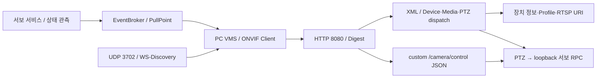
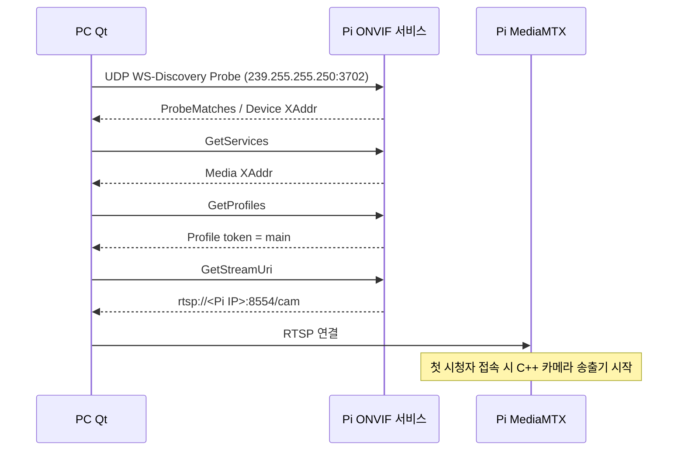

# Pi ONVIF Device / Media / PTZ / Events

## 디렉토리와 서비스 구조

```text
onvif_service/
├── CMakeLists.txt / install.sh / ptz-onvif.service
├── src/
│   ├── main.cpp         # 설정·서비스 시작
│   ├── network/         # HTTP / UDP discovery
│   ├── auth/            # HTTP Digest 인증
│   ├── xml/             # namespace-aware XML 파싱
│   ├── protocol/        # Device / Media / 요청 dispatch
│   ├── ptz/             # ONVIF 좌표 검증 → 내부 서보 RPC
│   ├── events/          # 상태 관측·PullPoint 이벤트
│   └── control/         # custom JSON 추적 설정·조회
├── tools/               # Discovery·조회·인증 설정 도구
└── tests/               # 프로토콜·인증·이벤트 확인
```



ONVIF 프로세스는 GPIO나 카메라를 직접 열지 않습니다. 표준 PTZ와 custom 추적
ON/OFF는 각각 별도 인터페이스이며 상세 계약은
[최신 보고서](../../docs/EDGE_CAMERA_SOFTWARE_REPORT.md)를 확인하세요.
아래 Qt 직접 연결 예시는 진단용입니다. 목표 운영 경로는 Qt → VMS → Pi입니다.

Qt가 Pi의 IP/RTSP 경로를 직접 입력하지 않고, LAN에서 Pi를 찾고 영상 주소를 조회하는
C++17 서비스다. 기존 MediaMTX의 `rtsp://<Pi IP>:8554/cam`을 반환한다.
ONVIF URL 조회는 카메라를 열지 않는다. 반환된 RTSP 주소에 시청자가 접속하면
기존 MediaMTX의 on-demand 설정이 카메라 송출기를 실행한다.

## 연결 흐름



## 빌드·설치

```sh
sudo apt install cmake g++ libexpat1-dev uuid-dev libcurl4-openssl-dev libssl-dev
cmake -S pi/onvif_service -B pi/onvif_service/build
cmake --build pi/onvif_service/build -j2
ctest --test-dir pi/onvif_service/build --output-on-failure
# 최초 설치 시 계정 파일을 먼저 생성한다. 비밀번호를 소스/명령행에 넣지 않는다.
read -r -s -p '접속 비밀번호: ' ptz_access_password
printf '\n'
printf '%s\n' "$ptz_access_password" | sudo ./pi/onvif_service/build/configure_access \
  --init /etc/ptz-camera/access.conf minsang
unset ptz_access_password
sudo ./pi/onvif_service/install.sh

# 기존 카메라 서비스에도 같은 계정을 적용한다.
sudo ./pi/onvif_service/build/configure_access --render-media \
  /etc/ptz-camera/access.conf pi/camera_stream/mediamtx.yml /etc/ptz-camera/mediamtx.yml
sudo systemctl restart ptz-camera.service
systemctl status ptz-onvif.service
```

서비스는 기본 `eth0`의 IPv4 주소를 사용한다. UUID는 machine-id와 프로젝트 전용
namespace로 생성해 재실행 후에도 유지한다. 원본 machine-id를 응답에 넣지 않는다.
자동 주소 모드에서는 요청마다 인터페이스 주소를 다시 읽는다. 인터페이스 자체를
변경할 때는 설정을 바꾸고 재시작한다.

Wi-Fi에서 사용하려면 `sudo systemctl edit ptz-onvif.service`에 다음을 넣는다.

```ini
[Service]
ExecStart=
ExecStart=/usr/local/libexec/ptz-onvif/ptz_onvif --interface wlan0
```

```sh
sudo systemctl daemon-reload
sudo systemctl restart ptz-onvif.service
journalctl -u ptz-onvif.service -f
sudo systemctl stop ptz-onvif.service
```

설치된 서비스만 새로 시작하며 기존 영상·서보 서비스를 재시작하지 않는다.
실행 사용자는 systemd가 생성하는 임시 `ptz-onvif` 계정, HTTP 포트는 TCP 8080, 장치 검색은 UDP 3702이다.
주소/포트는 `--advertise-ip`, `--port`, `--rtsp-port`, 인터페이스는 `--interface`로 설정한다.
`--bind 127.0.0.1 --no-discovery --allow-unauthenticated`는 로컬 HTTP 시험에만 사용할 수 있다.
운영 실행은 계정 파일이 없으면 시작에 실패한다.

## Pi에서 조회 확인

```sh
# 현재 eth0 주소가 192.168.0.92인 경우
./pi/onvif_service/build/onvif_probe 192.168.0.92
sudo env PTZ_CREDENTIALS_FILE=/etc/ptz-camera/access.conf \
  ./pi/onvif_service/build/onvif_query http://192.168.0.92:8080/onvif/device_service
```

`onvif_probe`는 multicast Probe를 보내고 응답의 Device XAddr를 출력한다.
`onvif_query`는 실제 HTTP SOAP으로 GetServices → GetProfiles → GetStreamUri를 호출한다.
중간 상태는 stderr, 반환된 RTSP URL은 stdout으로 출력한다. 두 도구는 Qt 없이
검색/조회 흐름을 검증하기 위한 Pi용 C++ 도구다.

## 지원 범위

| 기능 | 지원 |
| --- | --- |
| WS-Discovery | IPv4 / 2005/04 Probe 및 ProbeMatches, QName type 검사 |
| Device | GetServices, GetServiceCapabilities, GetCapabilities(Media/All), GetDeviceInformation, GetSystemDateAndTime, GetScopes |
| Media ver10 | GetServiceCapabilities, GetProfiles, GetProfile, GetStreamUri |
| 고정 프로파일 | main / H.264 / 1280×720 / 30fps / 2500kbps |
| 스트림 요청 | RTP_unicast / RTSP 또는 UDP. 두 경우 같은 RTSP URL 반환 |

UDP 스트림 요청은 `tt:Protocol=UDP`, RTSP TCP interleaving 요청은
`tt:Protocol=RTSP`로 보낸다. 실제 플레이어에서도 같은 전송 방식을 선택해야 한다.
HTTP tunneling, multicast RTP, 이벤트/설정 변경, Media2는 구현하지 않았다.
PTZ/추적은 인증된 ONVIF PTZ API, 탐지 알림은 ONVIF Events를 사용한다. TCP 5000은 Pi 내부 loopback IPC다.

이 서비스는 **주소 조회 목적의 ONVIF API 부분 구현**이다. WS-Security UsernameToken, HTTPS,
WS-Discovery Hello/Bye/Resolve, IPv6, ONVIF Profile S/T 전체 적합성은 제공하지 않는다.
HTTP Digest 인증을 제공하는 LAN 프로토타입이며 ONVIF 적합성 인증 제품으로 표시하지 않는다.
Scope 필터는 구현된 scope의 정확한 값만 지원한다. 범용 클라이언트에서는 Types를
사용하고 Scopes 필터는 생략한다. 같은 LAN의 multicast가 허용돼야 검색할 수 있다.
검색이 막히면 Device XAddr를 직접 지정해 조회할 수 있다.

HTTP는 SOAP 1.2와 Content-Length 요청을 받으며 요청마다 연결을 닫는다.
헤더 16KiB, XML 본문 64KiB, 연결 16개, 연결 처리 3초 제한을 둔다.
DTD/엔티티 선언, 잘못된 namespace/프로파일/전송 방식은 거부한다.
이 HTTP 수신기는 해당 요청 경로를 위한 최소 구현으로 HTTP/2나 chunked 요청을 지원하지 않는다.
프로파일 정보는 현재 송출 설정을 설명하므로 영상 설정을 바꾸면 함께 수정해야 한다.
URL 반환은 카메라의 현재 연결 여부나 즉시 재생 가능성을 보장하지 않는다.

## 소스 구조

```text
src/
├── main.cpp                 # 설정·안정적인 장치 UUID·신호 처리
├── xml/xml.h, xml.cpp       # namespace-aware Expat 파싱과 XML escape
├── protocol/service.*      # Device/Media SOAP 응답, ProbeMatches
├── auth/digest.*            # HTTP Digest, nonce 서명/만료, 재사용 방지
└── network/server.*        # nonblocking HTTP/UDP 이벤트 루프
```

모델 추론이나 영상 인코딩을 하지 않는 짧은 요청이므로 한 `poll()` 이벤트 루프에서
처리한다. 요청마다 스레드를 생성하지 않는다. 느린 HTTP 요청이 전체 서비스를
막지 않도록 비블로킹 수신/송신과 연결별 버퍼·기한을 사용한다.

## 공식 규격 참고

- [ONVIF Core 26.06](https://www.onvif.org/specs/2606/ONVIF-Core-Spec-v2606.pdf)
- [ONVIF Media Service 24.12](https://www.onvif.org/specs/2412/ONVIF-Media-Service-Spec-v2412.pdf)
- [Device WSDL](https://www.onvif.org/ver10/device/wsdl/devicemgmt.wsdl)
- [Media WSDL](https://www.onvif.org/ver10/media/wsdl/media.wsdl)

## 로그인 동작과 저장 위치

- WS-Discovery 검색은 로그인 없이 가능하다. HTTP SOAP 조회에는 인증이 필요하다.
- HTTP Digest 알고리즘은 SHA-256과 MD5를 제공한다. Qt는 QAuthenticator로 대응한다.
- 서명된 nonce의 유효기간은 120초다. 같은 요청 카운터 재사용은 거부하며 최근 64개
  카운터 창으로 병렬 요청의 도착 순서 변경을 허용한다. 재사용 기록은 최대 4096개다.
- `/etc/ptz-camera/access.conf`에 계정 정보를 저장한다. root 소유, 0600 권한이며
  systemd LoadCredential로 ONVIF의 임시 서비스 계정에 전달한다.
- 생성된 MediaMTX 설정도 root/0600이고 저장소 밖에 있다. 원본 YAML에는 계정을 넣지 않는다.
- MediaMTX는 외부 `/cam` 시청에 같은 계정을 요구한다. Pi 내부 loopback 주소의
  송출·워치독·metrics 접근은 예외로 허용한다. 외부 publish 권한은 주지 않는다.
- 초기 401은 Digest challenge 과정이다. 올바른 인증으로 재시도한 뒤에도 401이면
  사용자명/비밀번호나 클라이언트의 인증 처리를 확인한다.
- Digest는 로그인 인증이다. 영상 암호화나 HTTPS 제공을 의미하지 않는다.
- 외부 PTZ 문자열은 거부한다. TCP 5000은 loopback 전용이며 외부 추적/탐지 알림은 ONVIF로 제공한다.

계정 변경은 `configure_access --rotate FILE USER`에 새 비밀번호를 stdin으로 전달하고,
MediaMTX 설정을 다시 생성한 뒤 ONVIF·카메라 서비스를 재시작한다. 재설치 시 기존 계정
파일을 유지하며 카메라 설치 스크립트도 해당 계정을 반영한다.

```sh
sudo env PTZ_CREDENTIALS_FILE=/etc/ptz-camera/access.conf \
  ./pi/onvif_service/build/check_rtsp_auth rtsp://192.168.0.92:8554/cam
```

RTSP 확인 도구는 Digest 인증 후 DESCRIBE/SDP까지 검사한다. PLAY/전체 영상 재생을
검증하는 도구는 아니다. 비밀번호를 URL이나 argv에 넣지 않는다.

참고: [HTTP Digest RFC 7616](https://www.rfc-editor.org/rfc/rfc7616),
[MediaMTX 인증 설정](https://mediamtx.org/docs/features/authentication).

## ONVIF PTZ 제어

PTZ XAddr는 `http://<PI_IP>:8080/onvif/ptz_service`이다. GetServices에서 조회하며
Media 프로파일의 PTZConfiguration은 `ptz-config`, node는 `ptz-node`다.

- 지원: GetNodes/GetNode, GetConfigurations/GetConfiguration/GetConfigurationOptions,
  GetCompatibleConfigurations, GetServiceCapabilities, GetStatus, AbsoluteMove,
  RelativeMove, ContinuousMove, Stop, GetPresets(빈 목록).
- Pan/Tilt 좌표/변위/속도는 -1..1. Zoom/프리셋/optional Speed는 미지원이며 최신 소스는 GotoHomePosition을 제공한다.
- Continuous Timeout은 0.1..5초, 기본 1초. 최신 소스의 수동 명령은 수동 제어를 우선하며 사용자 추적 ON이면 유예 후 AUTO 복귀할 수 있다.
- 단일 GPIO 소유자인 서보 서비스에 loopback RPC로 전달한다. RPC 전체 기한은 300ms다.
- 상태 위치는 명령 각도이며 실제 엔코더 측정값이 아니다. Stop은 목표 갱신을 멈추고
  마지막 펄스를 유지한다. 물리적 비상정지 기능은 아니다.
- 공유 제한값은 `common/control/ptz_limits.h`, ONVIF 처리는 `src/ptz/`, 궤적 계산은
  `pi/servo_test/src/motion/`에 있다. 좌우 장착 반전 보정은 별도 작업으로 남아 있다.

```sh
# 기본은 상태 조회만 수행한다.
sudo env PTZ_CREDENTIALS_FILE=/etc/ptz-camera/access.conf \
  ./pi/onvif_service/build/onvif_ptz_check http://192.168.0.92:8080/onvif/device_service
```

`--zero-test`는 현재 명령 위치로 AbsoluteMove, 0변위 RelativeMove, 0속도 ContinuousMove,
Stop을 보내 연결 경로를 확인한다. 수동 제어 상태가 바뀔 수 있으므로 실물 시험으로 취급한다. 최신 소스의 추적 설정 OFF는 독립 JSON API로 수행한다.
실제 비영 이동 방향과 다른 ONVIF 클라이언트 호환성은 추가 현장 확인이 필요하다.

Qt 구현 요청서와 XML 예시는 [PTZ 전환 문서](../../docs/onvif_ptz_qt_migration.md)에 있다.

## ONVIF 추적과 Events

기존 운영 버전에서 MoveAndStartTracking/Stop과 Events/PullPoint를 사용했다. 최신 소스의 독립 추적 스위치와 Stop 동작은 배포 버전에 따라 구분한다.
bbox·시각·프레임 식별자·제조사 topic 및 제한은
[Pi 구현 기록](../../docs/EDGE_CAMERA_IMPLEMENTATION.md)에 정리했다.

```sh
PTZ_CREDENTIALS_FILE=/etc/ptz-camera/access.conf ./build/onvif_events_check \
  http://192.168.0.92:8080/onvif/device_service
```

이 도구는 구독/초기 알림/갱신/해제를 확인하며 이동이나 추적 시작은 요청하지 않는다.

## 현재 시스템 연동 기준 (2026-10-11)

Qt 라이브는 Pi 직접 RTSP, Web 라이브는 PC VMS 내부 libdatachannel WebRTC입니다. PC MediaMTX 게이트웨이는 제거했고 Pi RTSP 서버는 유지합니다. 녹화·SQLite·자연어 검색은 VMS 책임입니다.

최신 Pi 소스의 독립 /camera/control 추적 설정과 VMS의 기존 ONVIF Tracking 계약은 아직 맞춰야 합니다. 소스 업데이트가 설치 서비스 적용을 의미하지 않습니다. 전체 역할·검증 범위는 [저장소 README](../../README.md)를 기준으로 확인하세요.
