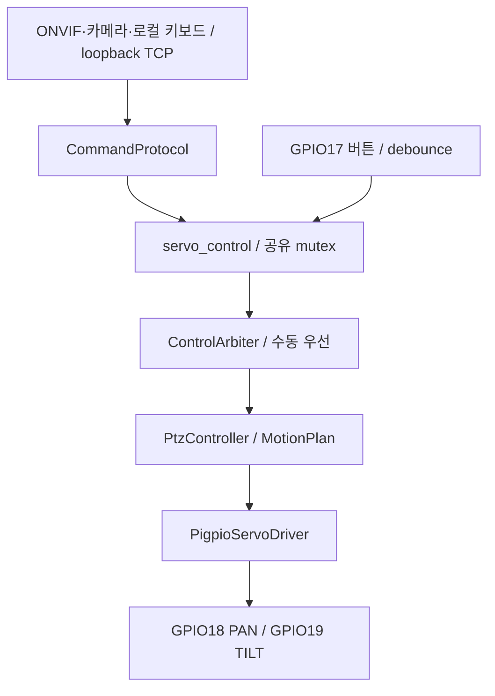

# Raspberry Pi 서보 제어

`servo_test`는 MG90S PAN/TILT 두 축과 중앙 복귀 버튼을 pigpio C API로 제어합니다.
GPIO는 BCM 번호 기준으로 PAN 18, TILT 19, 버튼 17입니다. 서보 전원은 외부
4.8~6V에서 공급하고 Pi GND와 외부 전원 GND를 공통 연결합니다.

## 소스 구조

`src/`에서 기능별 `.cpp`는 구현을, 같은 이름의 `.h`는 다른 파일에서 호출할
함수와 자료형의 선언을 담습니다. 함수 중심 구조이며 공유 각도와 잠금은
`servo/servo_control.cpp` 내부에서 관리합니다.

| 파일 | 역할 |
| --- | --- |
| `main.cpp` | 실행 모드 선택, 초기화, 입력 대기 루프, 종료 순서 |
| `config.h` | BCM GPIO, TCP 포트, debounce. 각도/속도는 common/control/ptz_limits.h 참조 |
| `motion/motion_plan.cpp/.h` | 목표 이동·속도·타임아웃의 순수 계산 |
| `servo/servo_control.cpp/.h` | 기존 함수 adapter, 공유 mutex와 객체 연결 |
| `control/` | ControlArbiter 우선순위·세대, PtzController 이동 계획 |
| `hardware/` | ServoDriver GPIO 초기화·pulse·종료 |
| `button/center_button.cpp/.h` | GPIO17 풀업 설정, active-low 콜백, debounce, 버튼 등록 해제 |
| `keyboard/keyboard_control.cpp/.h` | 터미널 설정·복원, 키 매핑, 직접 키 제어와 로컬 TCP 클라이언트 |
| `network/tcp_server.cpp/.h` | TCP 연결·해제, 연결별 수신 버퍼, 개행 기준 분리, 길이 제한, 메시지 송신 |
| `protocol/command_protocol.cpp/.h` | PTZ/TRACK/AUTO 명령 해석, 카메라 등록, Qt 상태 알림 |

```text
src/
├── main.cpp
├── config.h
├── control/     # ControlArbiter, PtzController
├── hardware/    # pigpio ServoDriver
├── motion/      # 궤적 계산
├── servo/       # 각도·펄스 제어
├── button/      # 중앙 복귀 버튼
├── keyboard/    # 터미널 키 입력
├── network/     # TCP 연결·수신 버퍼
└── protocol/    # 명령 해석·상태 알림
```

각 기능 디렉토리에 같은 이름의 `.h`와 `.cpp`가 함께 있습니다.

## 제어 구조



메인 입력 루프는 약 20ms마다 이동 계획을 갱신합니다. pigpio 버튼 콜백과 공유하는
상태는 mutex로 보호합니다. 최신 소스의 설정·수동 후 자동 복귀 정책은
[소프트웨어 보고서](../../docs/EDGE_CAMERA_SOFTWARE_REPORT.md)를 참고하세요.

읽을 때는 `main.cpp` → `protocol/command_protocol.cpp` → `servo/servo_control.cpp` 순서로
따라가면 TCP 명령이 실제 서보 펄스로 이어지는 흐름을 볼 수 있습니다.
버튼은 `button/center_button.cpp`에서 `centerServos()`를 호출합니다.

## 설치 및 실행

```sh
sudo apt install cmake g++ libpigpio-dev
sudo ./pi/servo_test/install.sh
systemctl status ptz-servo.service
```

설치 스크립트는 C++ 프로그램을 빌드하고 `ptz-servo.service`를 시작합니다.
부팅 후에도 서비스가 자동 시작됩니다. 서버를 끄려면
`sudo systemctl stop ptz-servo.service`를 실행합니다.

서비스가 실행 중일 때 `./pi/servo_test/build/servo_test`를 실행하면 로컬 TCP
클라이언트로 접속해 같은 키로 제어합니다. 이 경우 GPIO는 서비스 한 프로세스만
사용하며 `sudo`가 필요하지 않습니다. `--client`를 붙이면 클라이언트 모드를
명시할 수 있습니다.

서버를 거치지 않고 GPIO를 직접 테스트할 때는 서비스를 먼저 중지하세요. pigpio를
사용하는 두 프로세스를 동시에 실행할 수 없습니다.

```sh
sudo systemctl stop ptz-servo.service
sudo ./pi/servo_test/build/servo_test --direct
sudo systemctl start ptz-servo.service
```

터미널에서 `--server`를 붙이면 TCP와 키보드 제어를 동시에 사용할 수 있습니다.
키는 `a`/`d`(PAN), `w`/`s`(TILT), `c`(중앙), `q`(종료)입니다.

## Qt ONVIF PTZ와 내부 TCP

Qt의 이동 버튼·키보드는 VMS에 명령을 보내고 VMS가 인증된 ONVIF PTZ로 전달한다.
[Qt 변경 요청서](../../docs/onvif_ptz_qt_migration.md)에 endpoint, 좌표, 요청 예시가 있다.
외부 `PTZ:LEFT/RIGHT/UP/DOWN/CENTER`는 이제 거부한다.

Pi 내부 키보드 클라이언트는 기존 PTZ 명령을 사용한다. TCP 5000은 내부 ONVIF
게이트웨이·카메라 송출기·ONVIF 관측 연결을 담당한다. 외부 Qt는 이 포트에 접속하지 않는다.

| 명령 | 접근·동작 |
| --- | --- |
| PTZ:LEFT/RIGHT/UP/DOWN/CENTER | loopback 키보드 클라이언트만 허용, 기존 5°/중앙 복귀 |
| ONVIF:ABS/REL/VEL/STOP/STATUS | loopback 게이트웨이 전용, 목표·속도·정지·상태 |
| TRACK:ON/OFF | Pi 내부 진단용 추적 전환. 외부는 ONVIF 사용 |
| CAMERA:HELLO, AUTO:* | Pi 내부에 등록된 카메라 송출기 |

공유 제한값은 `common/control/ptz_limits.h`에 있다. PAN 25~155°, TILT 40~140°이다.
`src/motion/motion_plan.*`은 순수 궤적 계산을, Controller는 이동 계획을, Driver는
GPIO 출력을 담당한다. `servo_control`은 이 객체들의 공유 mutex와 adapter다. 약 20ms마다 목표를 갱신하며 절대/상대 이동은 15°/s, 연속 이동은 축별
최대 30°/s이다. 연속 이동은 명령 Timeout(최대 5초), Stop 또는 경계에서 중단된다.

최신 소스에서 중앙 버튼·로컬 키·수동 ONVIF 명령은 수동 제어를 우선하며 추적 설정 ON이면 유예 후 AUTO로 복귀할 수 있다. TRACK:ON은 기존 수동
궤적을 취소한다. Stop은 펄스를 끄지 않고 마지막 명령 위치를 유지한다.
상태는 출력 명령 기준이며 실물 위치나 기계적 정지 완료를 측정하지 않는다.

서보 서비스는 내부 CAMERA/DETECT2/NO_DETECTION 상태를 loopback 관측으로
ONVIF broker에 전달한다. 외부 탐지/추적 알림은 인증된 ONVIF Events를 사용한다.

```sh
journalctl -u ptz-onvif.service -u ptz-servo.service -f
```

ONVIF 로그에서 HTTP 상태와 인증 결과를, 서보 로그에서 ONVIF 내부 명령 및 각도
갱신을 확인한다. 정상 이동의 HTTP 200은 수락이며 실제 기계적 도착 보장은 아니다.

## 처리 시간·자원 사용량 측정

새 빌드에는 `PTZ_PERF_LOG`로 활성화하는 CSV 계측이 포함되어 있습니다.
측정 지점, 환경변수, 프로세스/스레드 자원 수집과 시험 조건은
[성능 측정 안내](../../docs/performance/README.md)를 참고하세요.

## 최신 Edge 계약

TCP 5000은 loopback 전용이다. 최신 외부 추적 설정은 /camera/control tracking_set/get이며 기존 ONVIF MoveAndStartTracking은 호환 경로다.
알림은 PullPoint를 사용한다. v2 명령·모드 세대·클래스 경계와 검증은
[Pi 구현 기록](../../docs/EDGE_CAMERA_IMPLEMENTATION.md)에 정리했다.

## 현재 시스템 연동 기준 (2026-10-11)

Qt 라이브는 Pi 직접 RTSP, Web 라이브는 PC VMS 내부 libdatachannel WebRTC입니다. PC MediaMTX 게이트웨이는 제거했고 Pi RTSP 서버는 유지합니다. 녹화·SQLite·자연어 검색은 VMS 책임입니다.

최신 Pi 소스의 독립 /camera/control 추적 설정과 VMS의 기존 ONVIF Tracking 계약은 아직 맞춰야 합니다. 소스 업데이트가 설치 서비스 적용을 의미하지 않습니다. 전체 역할·검증 범위는 [저장소 README](../../README.md)를 기준으로 확인하세요.
